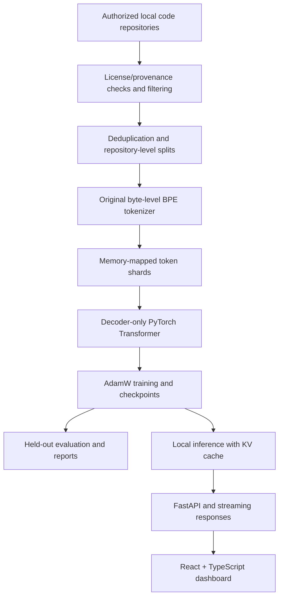

<div align="center">

# 🔥 CODEFIRE

### PRIYAN CODE AI · From-Scratch Coding Language Model Research

**Build the model. Own the pipeline. Measure the results.**

[](https://www.python.org/)
[](https://pytorch.org/)
[](https://fastapi.tiangolo.com/)
[](https://react.dev/)
[](https://www.typescriptlang.org/)
[](BUILD_STATUS.md)

[**Quick Start**](#-quick-start) · [**Architecture**](#-architecture) · [**Training**](#-training-your-own-model) · [**Verified Results**](#-verified-research-results) · [**Roadmap**](#-roadmap)


</div>

> [!IMPORTANT]
> **Research-stage project, not a production coding assistant.** CODEFIRE contains a real, locally tested end-to-end implementation. Its included **115,008-parameter smoke checkpoint** was trained for only **60 CPU steps** on a tiny original fixture and **does not generate useful code**. The **22,909,824- and 134,105,856-parameter configurations** passed limited forward/backward checks, **not large-scale pretraining**. See [BUILD_STATUS.md](BUILD_STATUS.md) before citing performance or capabilities.

## 🎯 Project vision

CODEFIRE (also documented internally as **PRIYAN CODE AI**) is an original, educational coding-LLM research stack for studying how language models are built, trained, evaluated, and served. It starts from random weights and uses an original byte-level BPE tokenizer rather than downloading a pretrained language model or delegating code generation to a commercial AI API.

The project brings together **data provenance, dataset preparation, Transformer training, checkpoint recovery, text generation, a typed local service, and an interactive research dashboard**. The goal is a reproducible path from small correctness tests toward progressively larger coding-language-model experiments—not unsupported claims of coding-agent performance.

## ✨ What is implemented?

| Area | Current capability | Status |
| --- | --- | --- |
| Model architecture | Decoder-only causal Transformer with RMSNorm, RoPE, SwiGLU and scaled dot-product attention | ✅ Implemented |
| Model sizes | 115K smoke model; ~23M and ~134M parameter research presets | ✅ Architecture checks |
| Tokenizer | Original byte-level BPE, byte coverage, special tokens and checksums | ✅ Implemented |
| Dataset pipeline | Authorized local code ingestion, provenance fields, permission gates, filters, deduplication, repository-level splits, token shards | ✅ Pilot implementation |
| Training | AdamW, gradient accumulation/clipping, learning-rate warmup and cosine decay, mixed-precision paths, checkpointing | ✅ Implemented; GPU not validated |
| Resume | Atomic checkpoint writes with model/optimizer/RNG/sampler state and integrity checks | ✅ Tested locally |
| Inference | Real model predictions; KV cache; temperature, top-k, top-p, repetition penalty and streaming | ✅ Smoke-level |
| Evaluation | Held-out cross-entropy/perplexity, syntax checks and saved reports | ✅ Fixture-level |
| Instruction tuning | Assistant-only masked supervised fine-tuning | ✅ One-step smoke test |
| API & UI | Local FastAPI service, SSE generation, React/TypeScript research dashboard | ✅ Tested in supplied environment |
| Agent utilities | Confined file reading, proposed diffs, optional Docker-only test function | 🧪 Limited utilities only |
| Full code-capable pretrained model | Large-corpus training and verified functional code benchmarks | ⏳ Not complete |
| Autonomous coding agent | Reliable planning/edit/test/repair loop | ⏳ Not implemented |

**Legend:** ✅ implemented or tested as described · 🧪 experimental/limited · ⏳ outstanding.

## 🧠 Architecture



### Transformer internals

The model architecture includes causal attention so each token can attend only to allowable earlier positions, **rotary positional embeddings (RoPE)** for positional information, **RMSNorm**, **SwiGLU feed-forward blocks**, residual connections, and an optional **KV cache** for generation. Configurations are stored in [`configs/`](configs/), with implementations in [`src/model/`](src/model/).

**Research presets:**

| Preset | Parameters | Intended use | Verified scope |
| --- | ---: | --- | --- |
| Smoke | 115,008 | Tiny end-to-end pipeline verification | 60 CPU training steps |
| 23M | 22,909,824 | Initial larger-model experiment | Short forward/backward test |
| 134M | 134,105,856 | Larger from-scratch experiment | Short forward/backward test |

> Model size alone does not imply useful code generation. Functional quality depends on dataset diversity, legally usable training material, optimization, compute, instruction tuning, and independent evaluation.

## 🧰 Technology stack

- **ML/model:** Python, PyTorch, NumPy, original BPE tokenizer and Safetensors export.
- **Configuration:** YAML experiment and dataset configuration.
- **Backend:** FastAPI, Uvicorn, HTTP streaming/SSE and local process controls.
- **Frontend:** React 19, TypeScript 5, Vite 7, Lucide React.
- **Quality:** Pytest, Vitest and frontend build checks.
- **Packaging and workflow:** Dockerfile, Makefile and shell/Python scripts.

See [`requirements.txt`](requirements.txt) and [`frontend/package.json`](frontend/package.json) for exact dependency versions.

## ⚡ Quick start

### Prerequisites

- **Python 3.11+** (Python 3.12 is recommended for the documented workflow).
- **Node.js 22+** and npm for the UI.
- Enough free disk space for your selected artifacts, corpus and environment.
- CPU for smoke tests; supported NVIDIA CUDA hardware is optional for larger training after verifying the installed PyTorch CUDA build.

### Clone and install (Windows PowerShell)

```powershell
git clone https://github.com/PRIYAN-A-1/CODEFIRE.git
cd CODEFIRE
py -3 -m venv .venv
.\.venv\Scripts\Activate.ps1
python -m pip install -r requirements.txt
python scripts/check_environment.py
python -m pytest -q
python scripts/smoke_test.py
```

**Run the API** (first terminal):

```powershell
python -m uvicorn backend.main:app --host 127.0.0.1 --port 8000
```

**Run the frontend** (second terminal):

```powershell
cd frontend
npm ci
npm run dev
```

- **Dashboard:** http://127.0.0.1:5173
- **Interactive API documentation:** http://127.0.0.1:8000/docs

The default local service uses the included tiny smoke-model artifacts where available. Output represents predictions from its actual weights, **not a capable coding assistant**.

### Linux / WSL2

```bash
git clone https://github.com/PRIYAN-A-1/CODEFIRE.git
cd CODEFIRE
bash scripts/setup.sh
source .venv/bin/activate
python scripts/check_environment.py
python -m pytest -q
python scripts/smoke_test.py
python -m uvicorn backend.main:app --host 127.0.0.1 --port 8000
```

Run `cd frontend && npm ci && npm run dev` in a second terminal. Linux CPU execution was verified in the project report; **native Windows, WSL2 and CUDA runs were not validated in that report**. For a GPU installation, select the correct build using the [official PyTorch installation guide](https://pytorch.org/get-started/locally/), then run the environment check and model probe.

## 🧪 Reproduce the small research fixture

Run the following from the repository root after activating your Python environment:

```bash
python -m src.data.collect --config configs/dataset.yaml
python -m src.tokenizer.train_tokenizer --config configs/dataset.yaml
python -m src.data.prepare --config configs/dataset.yaml
python -m src.training.train --config configs/train_smoke.yaml --resume checkpoints/latest
python -m src.evaluation.evaluate --checkpoint checkpoints/latest
python -m src.inference.generate --checkpoint checkpoints/latest --prompt "def fibonacci(n):" --max-new-tokens 24
python -m src.inference.export --checkpoint checkpoints/latest
```

The existing smoke experiment already reached its configured **60-step target**. Resuming with that unchanged target does not retrain it. For a fresh experiment, create a new configuration with a **new checkpoint directory and log**. Do not delete or overwrite an existing experiment implicitly.

## 🏋️ Training your own model

A meaningful coding model requires a larger, diverse, **authorized** code corpus and measured hardware capacity. The production dataset template intentionally requires real source and permission configuration.

### 1. Configure source data

Copy and edit [`configs/dataset_production.yaml`](configs/dataset_production.yaml). Supply local repositories for which you have suitable rights, provenance/license metadata and the required approval fields. **The project does not automatically crawl the internet or fetch repositories.** Avoid private secrets and personal information. Do not claim a dataset is fully cleared merely because a heuristic filter passes.

### 2. Build and inspect the tokenizer/dataset

```bash
python -m src.data.collect --config configs/dataset_production.yaml
python -m src.tokenizer.train_tokenizer --config configs/dataset_production.yaml
python -m src.data.prepare --config configs/dataset_production.yaml
python -m src.data.inspect --dataset data/production/tokenized
```

The production target vocabulary is **32,000 tokens**, depending on training corpus size; the smoke fixture learned **446 actual tokens** against a 512 target. Freeze tokenizer vocabulary before training a model that will depend on it. Keep training, validation and test repositories separate, and inspect deduplication limitations before scaling.

### 3. Probe hardware and train progressively

```bash
python -m src.training.probe --model configs/model_23m.yaml
python -m src.training.train --config configs/train_23m.yaml
```

After evaluating a successful 23M run, independently configure and train the larger model:

```bash
python -m src.training.train --config configs/train_134m.yaml
python -m src.training.train --config configs/train_134m.yaml --resume checkpoints/134m/latest
```

**Run one training job at a time.** Adjust context length, microbatch, accumulation and disk paths based on actual probe results. These commands **start training; they do not establish that the models are already pretrained**. The provided 23M/134M configurations have not been fully trained on a production code corpus.

### 4. Evaluate before claiming coding ability

```bash
python -m src.evaluation.evaluate --checkpoint checkpoints/134m/latest --tokenizer artifacts/production/tokenizer.json --dataset data/production/tokenized
```

Document held-out loss/perplexity and real coding-task outcomes. Isolated program execution, pass@1 scoring and broad benchmarks remain future work in the current build. Do not interpret toy fixture metrics as production benchmark performance.

## 📊 Verified research results

The following measurements are from [`BUILD_STATUS.md`](BUILD_STATUS.md), which documents the shipped research fixture—not a fully trained assistant.

| Verification | Reported outcome |
| --- | --- |
| Python tests | **43 passed** |
| Frontend component tests | **2 passed** |
| Frontend production build | **Passed** |
| Smoke model | **115,008 parameters** |
| CPU training | **60 optimizer steps** |
| Fixture data | **5 original code files** |
| Training loss | **6.247012 → 3.029353** (step 1 to step 60) |
| Held-out test loss | **6.489582** |
| Held-out test perplexity | **658.248** |
| Sample Python syntax validity | **0 / 2 completions** |
| API generation and SSE | **Passed local tests** |
| CUDA verification | **Unavailable in the reported test environment** |

> These are historical results reported by the repository, not fresh tests executed during this README preparation. For additional evidence, inspect [`reports/`](reports/) and [`evaluations/`](evaluations/).

## 🗂️ Repository structure

```text
CODEFIRE/
├── backend/                 # Local FastAPI backend
├── frontend/                # React / TypeScript dashboard
├── configs/                 # Dataset, model and training YAMLs
├── src/
│   ├── model/               # Decoder Transformer components
│   ├── tokenizer/           # Byte-level BPE
│   ├── data/                # Data ingestion and token shards
│   ├── training/            # Training, probes, resume, SFT
│   ├── inference/           # Sampling, KV cache, export
│   ├── evaluation/          # Loss, perplexity, syntax reports
│   ├── agent/               # Bounded repository tooling
│   └── system/              # System utilities
├── scripts/                 # Environment and smoke workflows
├── tests/                   # Python tests
├── docs/                    # Operating documentation
├── examples/                # Example materials
├── reports/                 # Research verification results
├── evaluations/             # Evaluation outputs
├── Dockerfile
├── Makefile
├── pyproject.toml
├── requirements.txt
├── BUILD_STATUS.md
└── README.md
```

Additional generated folders, such as `checkpoints/`, `artifacts/`, `data/` and `logs/`, depend on local workflows and may not be committed to Git.

## 🌐 Local API and dashboard

The backend is implemented in [`backend/main.py`](backend/main.py), and the UI is in [`frontend/`](frontend/). The dashboard offers research-oriented views for working with model outputs, training and system information. The API documentation at `/docs` is the authoritative source for currently registered endpoints and request schemas.

**Serving a separately trained production-config checkpoint:**

```powershell
$env:PRIYAN_CHECKPOINT="checkpoints/134m/latest"
$env:PRIYAN_TOKENIZER="artifacts/production/tokenizer.json"
$env:PRIYAN_DATASET="data/production/tokenized"
python -m uvicorn backend.main:app --host 127.0.0.1 --port 8000
```

Only use these settings **after** the matching assets exist. API key configuration is illustrated in [`.env.example`](.env.example). Keep the service bound to loopback for local work; a hardened authenticated reverse proxy and additional controls are necessary before remote exposure.

## 💽 Storage and resource planning

CODEFIRE does **not** enforce an artificial 50 GB application storage limit. Storage usage depends on corpus size, installed environments, tokenizer assets, checkpoint retention and training precision. Configurations support different local/mounted paths.

As a rough sizing reference, **200 million uint16 token IDs occupy about 400 MB** of raw token storage, excluding source repositories, manifests and metadata. A **134M-parameter FP32 weight copy is approximately 536 MB**; AdamW training and checkpoint recovery require substantially more disk and memory because of optimizer state and additional copies. Plan disk headroom for atomic saves. GPU VRAM requirements must be measured rather than guessed.

## 🛡️ Safety, provenance and trust

- Use only code data that you are authorized to process and redistribute as applicable.
- Review license terms, attribution and restrictions for each dataset source.
- Run independent secret, PII and contamination checks; the built-in filters are heuristic.
- Never load checkpoints from untrusted sources: training checkpoints contain trusted-local PyTorch serialized state.
- SHA-256 integrity checks detect accidental modifications but do **not** provide cryptographic source authentication against a malicious actor controlling both file and hash.
- Treat suggested code changes as drafts requiring review; do not advertise autonomous repairs or verified execution without evidence.
- Keep credentials out of Git and avoid exposing the development API directly to the internet.

## ✅ Testing and development commands

```bash
# From the repository root
python -m pytest -q
python scripts/smoke_test.py

# In another terminal
cd frontend
npm ci
npm test
npm run build
```

Shortcuts available in the [`Makefile`](Makefile): `make test`, `make smoke`, `make api`, and `make ui` (provided the environment supports `make`).

## 🗺️ Roadmap

- [x] Random-initialized causal Transformer implementation
- [x] Original byte-level BPE research tokenizer
- [x] Permission-gated local code collection prototype
- [x] CPU smoke training, checkpoint recovery and evaluation
- [x] Local HTTP inference, streaming and React dashboard
- [x] 23M and 134M architecture forward/backward checks
- [ ] Full authorized multi-language code dataset and license audit
- [ ] Hardware-verified CUDA training and performance characterization
- [ ] 23M and 134M corpus-scale pretraining
- [ ] Dedicated instruction-tuning evaluation and measurable improvements
- [ ] Isolated compilation and executable unit-test benchmark harness
- [ ] Scalable ingestion, improved fuzzy deduplication and contamination checks
- [ ] Reliable planner → patch → isolated test → review coding-agent workflow
- [ ] Production deployment hardening, model registry and monitoring

## 🤝 Contributing

Contributions are welcome through [issues](https://github.com/PRIYAN-A-1/CODEFIRE/issues) and [pull requests](https://github.com/PRIYAN-A-1/CODEFIRE/pulls). Include reproduction steps for bugs, keep experimental metrics reproducible, add tests for model/data changes, and avoid committing proprietary datasets, secrets or large checkpoint binaries.

## 📜 License

See the repository's [LICENSE](LICENSE) for the project's license terms. External datasets and dependencies may have separate licenses.

## 👨‍💻 Maintainer

Created and maintained by **[PRIYAN-A-1](https://github.com/PRIYAN-A-1)**.

- **Repository:** https://github.com/PRIYAN-A-1/CODEFIRE
- **Build and limitations:** [BUILD_STATUS.md](BUILD_STATUS.md)
- **API source:** [backend/main.py](backend/main.py)

---

<div align="center">

**CODEFIRE — Engineer the model. Verify the evidence. Earn the capabilities.**

⭐ If this project helps you learn from-scratch language model engineering, consider starring the repository.

</div>

